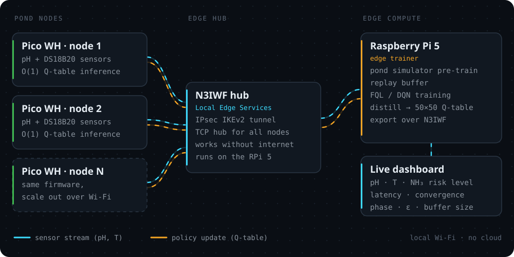
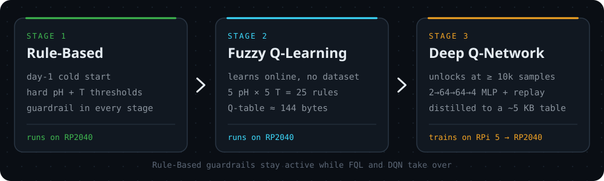

<div align="center">
  

  <p>
    
    
    
    
  </p>

  <b>Adaptive Aquaculture Water Quality Monitoring via Zebrafish Using<br>Progressive Hybrid FQL–DQN with N3IWF on a TinyML Embedded Platform</b>
</div>

<br>

> [!NOTE]
> This repository is a **showcase** of my thesis. The source code and field data are confidential and stay private.
> I'm happy to walk through the system in an interview: [LinkedIn](https://www.linkedin.com/in/faril-pirwanhadi-6b692b2a4) · [Email](mailto:farilpirwanhadi1@gmail.com)

## 🐟 The problem

Un-ionized ammonia (NH₃) is a silent killer in fish ponds: fish look normal right up until a sudden mass die-off. NH₃ toxicity is driven by **pH and temperature**, and the toxic fraction follows directly from those two readings, so the risk can be tracked **without an ammonia sensor**.

Most smart-aquaculture systems either run static rules that can't adapt, or rely on heavy models in the cloud, which is a poor fit for remote farms with unreliable internet.

## ⚙️ What I built

- 🧠 **Progressive hybrid learning.** Rule-Based → Fuzzy Q-Learning → Deep Q-Network: safe from day one, and increasingly adaptive as field data accumulates.
- 🧪 **NH₃-aware reward.** The reward signal comes straight from pH + temperature chemistry, with zebrafish (*Danio rerio*, a standard OECD test species in aquatic toxicology) as the biological reference.
- 📦 **Edge-to-MCU policy distillation.** The DQN trains on a Raspberry Pi 5, is evaluated over a 50 × 50 pH × temperature grid, and ships to the microcontroller as a ~5 KB lookup table. The RP2040 runs an O(1) argmax, with no matrix multiplies and no INT8 quantization.
- 📡 **5G N3IWF Local Edge Services.** An IPsec IKEv2 hub links every Pico WH node, the trainer and the dashboard over local Wi-Fi, with no internet connection required.
- 📊 **Live dashboard.** Shows pH, temperature, NH₃ risk level, inference time, N3IWF latency and learning convergence, along with the active phase, ε and replay-buffer size.

## 🗺️ System architecture



## 🪜 How it learns



| Stage | What it is | Why it's there |
| :--- | :--- | :--- |
| **Rule-Based** | Hard pH + temperature thresholds | A DQN can't learn on live fish, so monitoring has to be safe from day one |
| **Fuzzy Q-Learning** | 5 pH × 5 temperature fuzzy sets = 25 transparent IF-THEN rules, updated by TD learning | Learns from field data immediately and fits easily in 264 KB of SRAM |
| **Deep Q-Network** | 2 → 64 → 64 → 4 MLP with experience replay and a target network | Captures the non-linear pH–temperature–NH₃ relationship once enough data exists |

Each fuzzy rule is updated in proportion to its firing strength μᵢ:

```text
Q(s,a) ← Q(s,a) + α · μᵢ · [ r + γ · max Q(s′) − Q(s,a) ]
```

## 🧪 The chemistry behind the reward

```text
NH₃ fraction = 1 / (1 + 10^(pKa − pH))
pKa(T)       = 0.09018 + 2729.92 / (T + 273.15)        T in °C
```

High pH and warm water push ammonia into its toxic NH₃ form, while a pH below 6.5 brings acidosis risk on its own. The reward covers both sides, and each reading is classified as **Safe**, **Caution**, **Warning** or **Critical**.

## 🔧 Hardware & stack

| Layer | Components |
| :--- | :--- |
| **Sensor node** | Raspberry Pi Pico WH (RP2040, dual Cortex-M0+, 264 KB SRAM) · analog pH probe · DS18B20 1-Wire temperature sensor · C with the Pico SDK |
| **Edge compute** | Raspberry Pi 5 · Python · PyTorch / NumPy · pond simulator for pre-training |
| **Network** | Wi-Fi · 5G N3IWF Local Edge Services · IPsec IKEv2 · TCP |
| **Dashboard** | Web dashboard served from the edge, readable from any device on the farm Wi-Fi |

## 📈 What was evaluated

- **Learning convergence:** reward across the Rule-Based, FQL and DQN phases
- **N3IWF network performance:** RTT, jitter and packet delivery ratio over the IPsec IKEv2 tunnel
- **Sensor validation:** pH and temperature readings against reference measurements
- **End-to-end integration:** sensor → AI → 5G, observable live in one dashboard

Detailed results and field data are confidential.

## 👤 About

**Faril Pirwanhadi**, Embedded Systems Engineer (TinyML · Reinforcement Learning · IoT)<br>
Thesis at the Department of Electrical Engineering, Ming Chi University of Technology, Taiwan.<br>
Advisors: Yi-Chih Tung and En-Cheng Liou.

More of my work: [github.com/latverian](https://github.com/latverian)

## 📄 License

© 2026 Faril Pirwanhadi. **All rights reserved.** The text, diagrams and images in this repository may not be copied, modified or redistributed without written permission. See [LICENSE](LICENSE).
